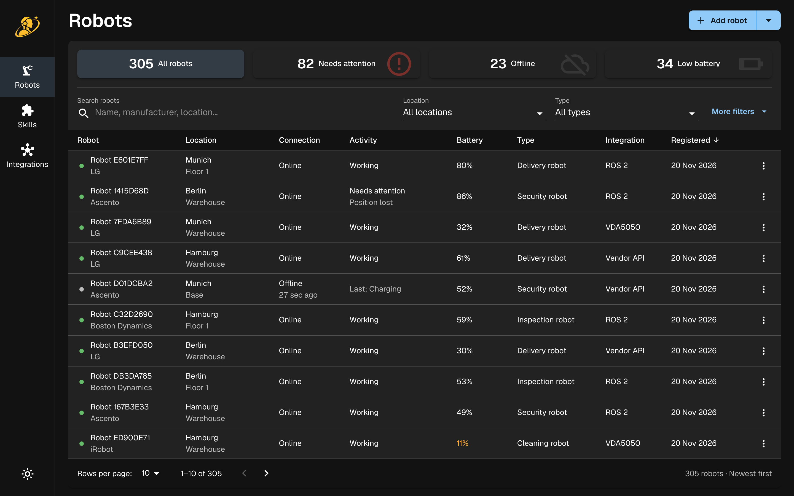
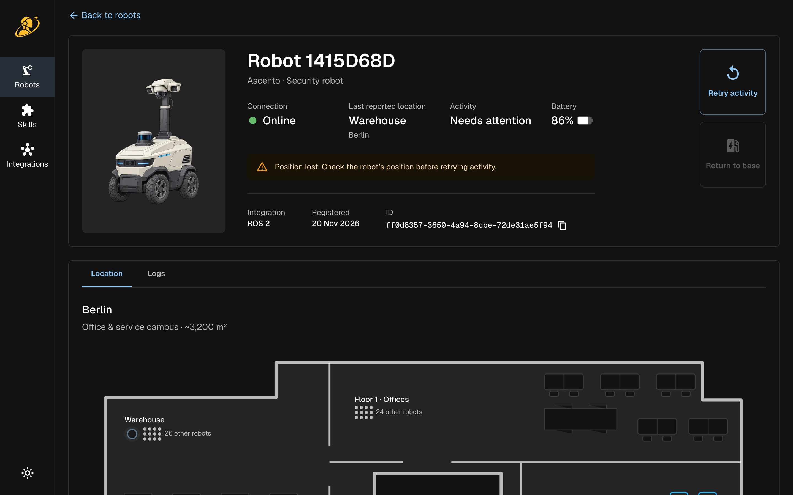
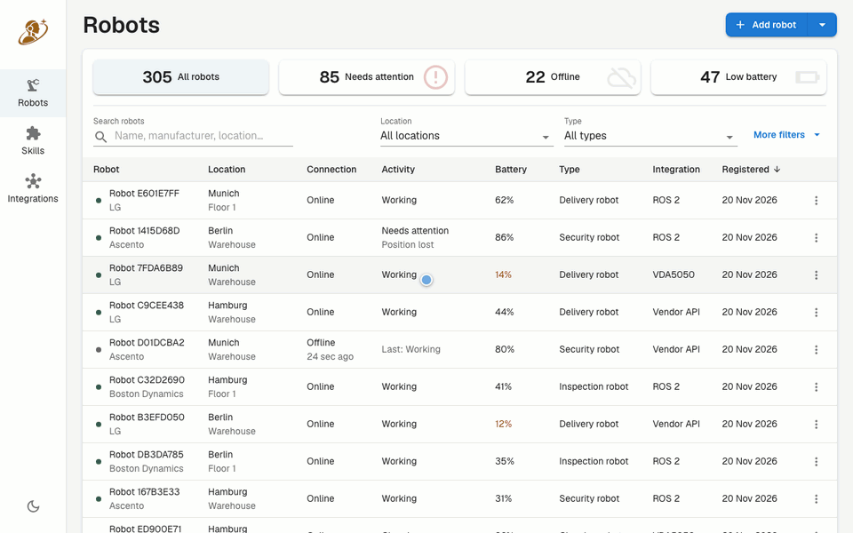

# Fleet Orchestrator

A frontend proof of concept for monitoring and controlling a mixed robot fleet, built for the Olivaw engineering challenge. The UI is the product here. The simulator and server exist to give it live data, failures and delayed commands to handle.







## Quick start

Requires Node.js 26 and npm.

```bash
npm ci
npm run db:setup
npm run dev
```

In a second terminal:

```bash
npm run simulator
```

Open http://localhost:3000/robots and add 1, 10 or 100 generated robots.

| Check                | Command            |
| -------------------- | ------------------ |
| Unit and integration | `npm test`         |
| End to end           | `npm run test:e2e` |
| Lint                 | `npm run lint`     |
| Unused code          | `npm run knip`     |

## The interface

A fleet manager needs to find the robots that need attention, understand their current state and act safely. The two screens follow that order.

**Fleet view**

- Counts for All, Needs attention, Offline and Low battery lead the page and double as filters.
- Search and filters sit directly above a paged table, and the current view lives in the URL so it can be reloaded or shared.
- Columns keep fixed widths, so values stay in place as live data changes.
- Loading, empty, no-results and failed states each have their own layout. Previous rows stay visible while the next view loads.

**Robot view**

- One summary card brings together identity, live values and available actions.
- A site map shows where the robot is among the others at its site.
- On narrower screens, the picture and actions move into a single reading order.

**UX decisions**

- **Old data is labelled.** Values read as _last reported_ once they may be out of date. If a refresh fails, the last good data stays on screen with a warning.
- **Actions explain themselves.** An unavailable action says why, for example "Battery too low to start".
- **Commands show their progress.** A command appears as sending, then queued until the robot reports applying it.
- **Keyboard focus is preserved.** Focus has a sensible place to go when a live update or deletion removes the control that held it.

## Frontend architecture

```text
URL → list params → TanStack Query → screen → sections
                          ↑                      │
                          └────── mutations ◀────┘
```

| State                            | Owner                    |
| -------------------------------- | ------------------------ |
| Filters, search, page, page size | URL                      |
| Server data and polling          | TanStack Query           |
| Pending writes                   | TanStack Query mutations |
| Search draft, dialogs, focus     | Local component state    |

The list screen parses the URL, passes the result to one polling query and gives each section the data it renders. Controls own their writes. When a write succeeds, its response updates the cache and a background refresh reconciles the view. Requests sent before the write are cancelled so they cannot restore older data.

The UI does not re-implement fleet rules. Each robot arrives with its connection, battery level and blocked actions already worked out, so the components only decide how to present them.

| Path              | Responsibility                                  |
| ----------------- | ----------------------------------------------- |
| `src/ui/features` | Product screens and their data hooks            |
| `src/ui`          | Layout, theme, query setup and notifications    |
| `src/app`         | Next.js pages and API route entry points        |
| `src/common`      | Contract shared by the UI, server and simulator |
| `src/server`      | Demo backend                                    |
| `src/simulator`   | Demo robots, connected only through HTTP        |

## Large fleets in the UI

The browser's work stays bounded as the fleet grows. Search, filters, counts and pagination run on the server, and the table renders at most 50 rows, so it does not need virtualization. Polling fetches only the page on screen.

## What I faked or left out

- **Backend:** a small Next.js and SQLite server, sized for this demo. It is not a production ingestion design.
- **Robots:** simulated by a Node process posting telemetry over HTTP.
- **History:** only the latest report is stored, and the robot logs are sample data.
- **Location map:** an illustrative floor plan, because reports contain an area name.
- **Skills and Integrations:** navigation placeholders.
- **Security:** no authentication, roles or command audit trail.
- **Localization:** English and Europe/Berlin only.

## With more time or in production

**Product**

- **Vendor capabilities:** drive controls from what each robot reports it can do, so a new manufacturer or skill needs no UI change.
- **Incident workflow:** turn "Needs attention" into a queue operators can acknowledge, assign and resolve.
- **Command lifecycle:** track each command from sent to applied or failed, with idempotency keys, history and role-aware controls.
- **Fleet workflows:** add bulk actions and saved views.

**Frontend architecture**

- **Live updates:** replace polling with server-sent events that carry only changed robots, with a fresh snapshot after a reconnect.
- **API contract:** validate responses at the boundary and version the contract, since an on-prem backend can be older than the UI.
- **List state:** put URL reads and writes behind one list-state hook, and replace the combined query flags with one explicit content state.
- **Search and focus:** move search syncing into its own hook, and give focus destinations one owner.

**Team and operations**

- **Guardrails:** enforce module boundaries in lint and keep a render budget for the largest page, 50 rows, on slower devices.
- **Observability:** track client errors, failed refreshes and command latency.

## Testing

- **Vitest:** components with the app's real providers and theme, plus the rules behind what they display.
- **Playwright:** core flows for filtering, search, paging, commands, deletion and navigation, using an isolated server and database.
